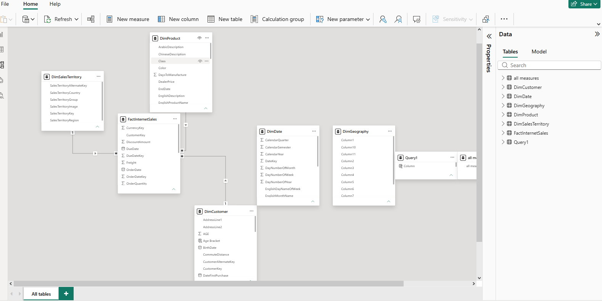
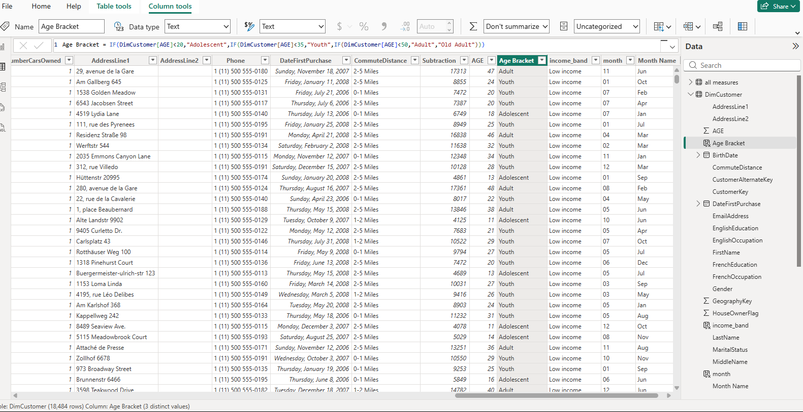
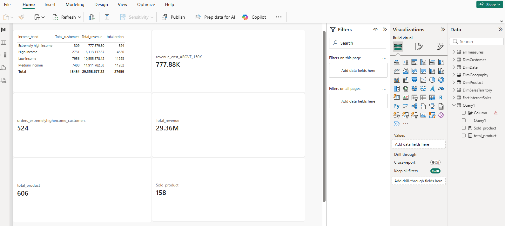

# AdventureWorks Sales Analytics & Data Modeling | Power BI

## 📌 Project Overview

This project demonstrates end-to-end data preparation, data modeling, customer segmentation, and business intelligence using the **AdventureWorks dataset in Power BI**.

The project focuses on building a Star Schema data model, developing DAX calculated columns and measures, and analyzing sales performance across customer income segments.

---

## 🏗️ Data Architecture & Modeling

Built a Star Schema relational data model connecting fact and dimension tables to support accurate and efficient analysis.

- **Fact Table:** `FactInternetSales`
- **Dimension Tables:** `DimCustomer`, `DimDate`, `DimProduct`, `DimSalesTerritory`, `DimGeography`
- **Relationships:** One-to-many (`1:*`) relationships with single-direction filtering from dimension tables to the fact table.

### Data Model View



---

## 🧹 Data Cleaning & Calculated Columns

Created custom DAX calculated columns to improve customer segmentation and support more detailed analysis.

### 1. Customer Age Segmentation — `Age Bracket`

```dax
Age Bracket =
IF(
    DimCustomer[AGE] < 20, "Adolescent",
    IF(
        DimCustomer[AGE] < 35, "Youth",
        IF(
            DimCustomer[AGE] < 50, "Adult",
            "Old Adult"
        )
    )
)
```

### 2. Customer Income Segmentation — `income_band`

```dax
income_band =
SWITCH(
    TRUE(),
    DimCustomer[YearlyIncome] < 50000, "Low income",
    DimCustomer[YearlyIncome] < 90000, "Medium income",
    DimCustomer[YearlyIncome] < 150000, "High income",
    "Extremely high income"
)
```

### 3. First Purchase Month — `month`

```dax
month =
FORMAT(DimCustomer[DateFirstPurchase], "MM")
```

### DAX Calculated Columns



---

## 📐 DAX Measures & Key Performance Indicators

Developed DAX measures to evaluate sales performance, customer activity, order volume, and product coverage.

### Core KPIs

| Metric | Value |
|---|---:|
| Total Revenue | $29.36M |
| Total Customers | 18,484 |
| Total Orders | 27,659 |
| Products Sold | 158 |
| Total Product Catalog | 606 |

### Advanced DAX Analysis

- High-income customer revenue analysis for customers earning above $150,000.
- Order count analysis for extremely high-income customers.
- Revenue and order comparisons across customer income segments.

### Power BI Measures & Report View



---

## 📊 Key Business Insights

- **Low-income and medium-income segments** contribute the largest reported revenue totals, at approximately $10.55M and $11.91M respectively.
- These segments also account for more than 11,000 orders each, based on the reported analysis.
- Customer income segmentation supports comparisons of purchasing behavior and revenue contribution across income groups.
- DAX measures make it possible to evaluate customer activity, sales performance, and product coverage within the Power BI report.

---

## 🛠️ Tools & Technologies

- **Power BI Desktop**
- **DAX (Data Analysis Expressions)**
- **Data Modeling**
- **Star Schema**
- **Data Cleaning & Transformation**
- **Customer Segmentation**
- **Business Intelligence & KPI Analysis**

---

## 📁 Files Included

- `AdventureWorks.pbix` — Power BI workbook containing the data model, calculated columns, measures, and report.
- `Model_view.png` — Screenshot of the data model and table relationships.
- `dax_columns.png` — Screenshot of DAX calculated columns.
- `Measure_report.png` — Screenshot of the Power BI report and measures.

---

## 🎯 Project Objective

To demonstrate practical skills in Power BI data modeling, DAX calculations, customer segmentation, and business-focused sales analysis by transforming a relational dataset into actionable insights.
